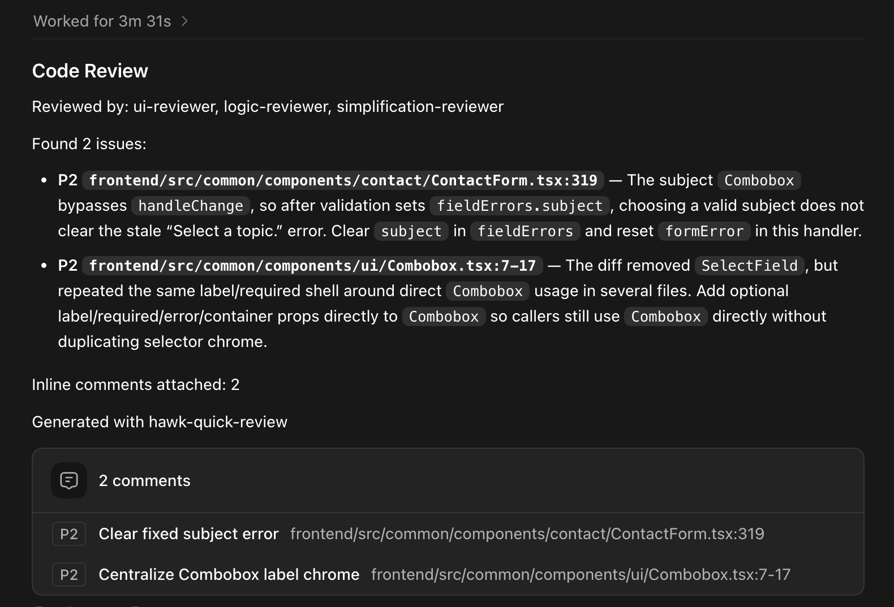
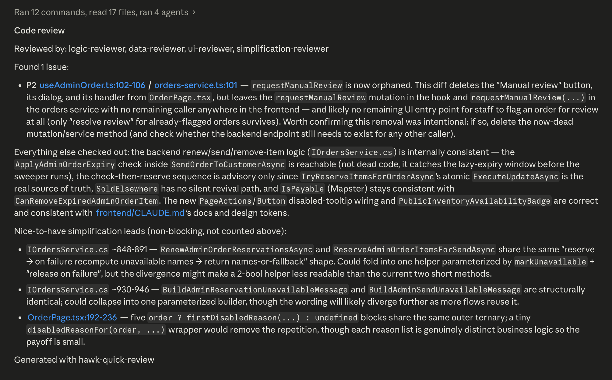

# hawk-quick-review

Reviews your uncommitted local changes before a commit, with reviewer perspectives picked from what changed.

## When to use

- When you ask to review local changes or the worktree before a commit.
- For an existing area without a diff use [hawk-project-review](hawk-project-review.md).

## How it works

- Every run covers all uncommitted changes, also right after fixes, unless you narrow the scope.
- Fresh researchers (UI, logic, data, security, API, always simplification) gather candidates; they run on the host's
  middle tier or stronger, never above the chat's own model.
- The main agent checks each candidate against the source and reports only evidence-backed findings (`F1`), up to three
  each of simplification leads (`S1`) and test ideas (`T1`), plus a suggested commit message.
- Every run checks knowledge and Codex/Claude compatibility, including that docs were closed after the work.
- Read-only: fixes go to [hawk-fix-review-findings](hawk-fix-review-findings.md).

## Invoke

- Claude Code: `/hawk-quick-review`; Codex: `$hawk-quick-review`
- Focus: `/hawk-quick-review Make sure data consistency is not compromised`
- Staged only: `/hawk-quick-review staged`
- Some paths only: `/hawk-quick-review only src/api check error handling`
- Since the previous review in this chat: `/hawk-quick-review only the latest changes`
- Explicit parallel researchers: `$hawk-quick-review using parallel sub-agents`

Text after the command is focus; only `staged`, "only the latest changes" or paths after "only", "just" or "limit to"
narrow the scope. Changes outside it are listed as not reviewed, and readiness covers only that scope. It is a review
step you run, not an installed Git hook.

The full workflow is in [SKILL.md](../../skills/hawk-quick-review/SKILL.md).
